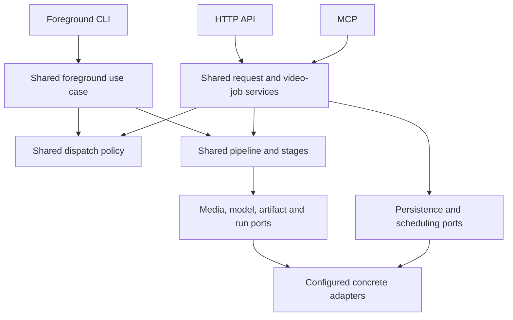

# Scrub


Turn YouTube videos and local audio/video into knowledge artifacts. Scrub
downloads media, transcribes speech, extracts key frames, and assembles a prompt
plus JSON output schema. Optionally run configured vision and summary models to
produce validated analysis, a structured summary, and Markdown. The default local
CLI stops after preprocessing so an agent harness can use its own models.

Use the same processing stages from the local CLI or through persistent background
jobs on a standalone Node host or Rivet. Submit a video or playlist, disconnect,
and poll for progress and artifacts later. HTTP, MCP, and server-side library
integrations provide job access; a browser dashboard is not included.

## Capabilities

- YouTube videos/playlists and local `.mp3`/`.mp4` input.
- Configurable transcription with local Whisper, faster-whisper, hosted adapters,
  and YouTube captions.
- Scene-based frame extraction with a fallback for sparse scenes.
- Transcript JSON/text, frame manifests, metadata, prompt/schema, manifests, and stats.
- Optional frame analysis, structured summaries, Markdown, and model usage records.
- CLI commands for the full pipeline and individual stages.
- Checkpoint reuse, bounded concurrency, cancellation, and retry through the
  application/storage/runtime adapters.
- Portable core/application source, separate from CLI/API hosting and native adapters.

## Local installation

Use Node.js 22.13+, yt-dlp, FFmpeg/FFprobe, and at least one suitable transcription
adapter. Local transcription needs its executable/package and model assets;
hosted transcription needs the corresponding provider secret.

```bash
git clone https://github.com/jona/scrub-cli.git
cd scrub-cli
npm install
npm run build
npm link

# macOS native tools
brew install yt-dlp ffmpeg

# Optional Python transcription
pip install faster-whisper
```

Run `scrub doctor` to inspect tools/settings, or `scrub transcribers` to inspect
adapters. Local Whisper can be configured with an executable path and model
directory. The Rivet image supplies its own tools and base model.
Set `SCRUB_PYTHON_PATH` to the Python executable containing `faster-whisper` when
it is installed in a different environment from the `python3` on your PATH.

## CLI configuration

The local composition reads `~/.scrub/config.json`. It keeps user settings and
optional provider secrets outside the repository. Server deployments
receive separately injected runtime configuration.

```json
{
  "transcription": {
    "priority": [
      "faster-whisper",
      "local-whisper",
      "openai",
      "youtube-captions"
    ],
    "whisperModel": "base",
    "language": "en"
  },
  "visual": { "enabled": true, "sceneThreshold": 0.4, "maxFrames": 20 },
  "output": { "directory": "~/.scrub/docs", "includeFullTranscript": false },
  "cache": { "directory": ".cache" },
  "localWhisper": {
    "binaryPath": "/path/to/whisper.cpp/main",
    "modelsPath": "/path/to/whisper.cpp/models"
  }
}
```

Optional hosted keys use `apis.openai`, `apis.anthropic`, and `apis.deepgram` in this
user file. `OPENAI_API_KEY` and `ANTHROPIC_API_KEY` environment values take precedence
for vision and summary models. Keep these values out of source control.
Paths may use `~`. Override output with `-o, --output-dir` on `youtube` and `file`.

## CLI commands

```bash
scrub youtube https://www.youtube.com/watch?v=dQw4w9WgXcQ
scrub youtube 'https://www.youtube.com/playlist?list=PL_example123' --max-videos 5 --parallel 2
scrub file ./recording.mp4
scrub file ./podcast.mp3

# Opt in to vision, summary generation, and Markdown rendering
scrub youtube https://www.youtube.com/watch?v=dQw4w9WgXcQ --summarize
scrub youtube https://www.youtube.com/watch?v=dQw4w9WgXcQ --summarize --no-visuals
scrub file ./recording.mp4 --summarize --summary-provider anthropic --vision-provider openai

# Development uses the same local composition
npm run dev -- youtube https://www.youtube.com/watch?v=dQw4w9WgXcQ
```

| `scrub youtube` option                                 | Behavior                                                                                        |
| ------------------------------------------------------ | ----------------------------------------------------------------------------------------------- |
| `-o, --output-dir <path>`                              | Override output directory                                                                       |
| `-t, --transcriber <name>`                             | Select `local-whisper`, `faster-whisper`, `openai`, `deepgram`, or `youtube-captions`           |
| `--no-visuals`                                         | Skip video download, frame extraction, and vision model calls; keep transcription and summaries |
| `--scene-threshold <n>`                                | Scene threshold, default 0.4                                                                    |
| `--max-frames <n>`                                     | Frame limit, default 20                                                                         |
| `-v, --verbose`                                        | Detailed progress                                                                               |
| `--max-videos <n>`                                     | Bound playlist entries                                                                          |
| `--parallel <n>`                                       | Bound per-request concurrent processing, default 1                                              |
| `--no-skip-existing`                                   | Force reprocessing                                                                              |
| `--summarize`                                          | Run configured vision/summary models and render Markdown                                        |
| `--summary-provider <name>` / `--summary-model <name>` | Override the summary selection; requires `--summarize`                                          |
| `--vision-provider <name>` / `--vision-model <name>`   | Override the vision selection; requires `--summarize`                                           |

`file` supports the media options above, excluding playlist options. MP3 input
always skips frames. YouTube input is parsed into canonical, validated video or
playlist identities.

Individual stages remain available:

```text
scrub download <youtube-url> [-o ./download] [--no-video]
scrub prepare <local.mp3|mp4> [-o ./prepare] [--no-video]
scrub transcribe <audio.wav> [-o ./transcript.json] [-t openai] [--text]
scrub extract-frames <video.mp4> [-o ./frames.json] [--output-dir ./frames]
scrub prompt <file> [-o ./summary.prompt.md] [--schema ./summary.schema.json] [--metadata path] [--visuals path]
scrub render <summary.json> [-o ./summary.md] [--metadata path] [--transcript path]
```

`prompt` accepts transcript JSON, plain text, and Markdown. Send its prompt to any
model, validate the response against its schema, then run `render`. Full transcript
rendering follows `output.includeFullTranscript`. No model is selected or called
by these commands.

### Model configuration

The local and Rivet compositions use the same provider registry. The shipped
profiles are `openai` using the OpenAI-compatible protocol and `anthropic` using
Anthropic's protocol. Public selections are persisted with jobs; credentials and
provider endpoints remain in the server-owned model adapter. Full processing
checks configured credentials and allowed selections before media work begins.

| Setting                                             | Purpose                                                                                       |
| --------------------------------------------------- | --------------------------------------------------------------------------------------------- |
| `OPENAI_API_KEY`, `ANTHROPIC_API_KEY`               | Provider secrets; server environment, local user configuration, or protected deployment input |
| `SCRUB_SUMMARY_PROVIDER`, `SCRUB_SUMMARY_MODEL`     | Default summary selection                                                                     |
| `SCRUB_VISION_PROVIDER`, `SCRUB_VISION_MODEL`       | Default vision selection                                                                      |
| `SCRUB_OPENAI_MODELS`, `SCRUB_ANTHROPIC_MODELS`     | Comma-separated model allowlists                                                              |
| `SCRUB_OPENAI_BASE_URL`, `SCRUB_ANTHROPIC_BASE_URL` | Trusted deployment endpoint overrides                                                         |
| `SCRUB_INFERENCE_LIMITS`                            | JSON object overriding bounded inference limits                                               |
| `SCRUB_MODEL_TIMEOUT_MS`                            | Runtime deadline per model call, 1–1,800,000 ms; default 600,000 ms (10 minutes)              |

Both stages default to `openai`: summaries use `gpt-6.1-sol` and vision uses
`gpt-6.1-terra`. The default OpenAI allowlist includes these models and
`gpt-6-luna`. Selecting `anthropic` without a model override uses
`claude-sonnet-5-5`. Additional model names must appear in the
corresponding allowlist. CLI flags override these public defaults. Library callers
inject a `StructuredModelGateway`; portable code imports no provider SDK.

`SCRUB_INFERENCE_LIMITS` sets the runtime's defaults and request ceilings for
API/MCP jobs. Requests may lower individual budgets, but cannot increase them
above the configured server policy. The CLI loads the same defaults from its
environment. These settings are also available to library callers through the
injected inference settings; the shared pipeline reads no environment variables.

| Budget                          | Default | Behavior                                                                                                                                                                     |
| ------------------------------- | ------- | ---------------------------------------------------------------------------------------------------------------------------------------------------------------------------- |
| `chunkCharacters`               | 48,000  | Maximum source characters per notes/compression chunk; source text is split without truncation                                                                               |
| `maxSummaryInputCharacters`     | 64,000  | Maximum final summary user-prompt characters, including template, metadata, evidence, JSON schema, and repair instructions; a character estimate, not a provider token count |
| `sourceNoteTargetCharacters`    | 9,000   | Soft notes target, reduced to fit the available input budget; oversized valid notes are accepted and compressed if needed                                                    |
| `initialSourceNoteOutputTokens` | 8,192   | Starting generation allowance for a notes/compression call                                                                                                                   |
| `initialOutputTokens`           | 16,384  | Starting generation allowance for a final summary                                                                                                                            |
| `maxOutputTokens`               | 32,768  | Hard ceiling for notes and summary generation; lower ceilings also lower both starting allowances                                                                            |
| `outputTokenRetries`            | 2       | Maximum allowance increases per paid step when the provider reports output truncation; each increase doubles the allowance up to the hard ceiling                            |
| `repairAttempts`                | 1       | Additional attempts for structurally invalid model output                                                                                                                    |
| `maxModelCalls`                 | 128     | Total paid attempts per video, including notes, vision, repairs, and token recovery                                                                                          |

For example, this allows summaries to start at 16,384 tokens and recover up to
32,768 tokens, with a fifteen-minute deadline per call:

```bash
export SCRUB_MODEL_TIMEOUT_MS=900000
export SCRUB_INFERENCE_LIMITS='{"initialOutputTokens":16384,"maxOutputTokens":32768,"outputTokenRetries":2}'
```

Valid notes have no fixed 12,000-character rejection threshold. When their
combined summary prompt exceeds the input budget, the pipeline compresses all
notes in bounded chunks until the prompt fits. It stops if compression does not
shrink the input or the total call budget is exhausted. It never trims source
text to make a prompt fit. Recovery counters and increased allowances are saved
before another paid call, so restarting a worker preserves the budgets and
completed steps. Previously accepted jobs retain their captured settings.

Native tools keep complete, size-bounded stdout for machine-readable results.
Diagnostic stderr and artifact-producing command stdout retain bounded tails;
callbacks stream the full diagnostics. Progress output cannot exhaust an
ever-growing log buffer or fail an otherwise successful download. Deadlines,
cancellation, metadata size checks, and media/artifact size limits remain active.

Provider/model selectors, allowlists, inference budgets, and the model-call deadline are also Docker build arguments. For example,
`--build-arg SCRUB_VISION_PROVIDER=anthropic --build-arg SCRUB_VISION_MODEL=claude-sonnet-5-5`
selects Anthropic for vision. Provider keys are never build arguments.

### Optional LangSmith tracing

CLI, standalone API/MCP, and Rivet deployments can trace model calls through the
same server-side adapter. Tracing is off by default. Enable it with
`LANGSMITH_TRACING=true` and supply `LANGSMITH_API_KEY` through an ignored,
owner-only env file or the deployment credential store. The key is never a
Docker build argument, job setting, result artifact, or browser configuration.

| Setting                           | Default                           | Purpose                                                                    |
| --------------------------------- | --------------------------------- | -------------------------------------------------------------------------- |
| `LANGSMITH_TRACING`               | `false`                           | Strict `true` or `false`; enables model-call tracing                       |
| `LANGSMITH_PROJECT`               | `scrub`                           | Destination project                                                        |
| `LANGSMITH_ENDPOINT`              | `https://api.smith.langchain.com` | HTTPS tracing endpoint without URL credentials, query, or fragment         |
| `LANGSMITH_WORKSPACE_ID`          | Unset                             | Optional workspace selection                                               |
| `SCRUB_LANGSMITH_CAPTURE_CONTENT` | `false`                           | Strict `true` or `false`; explicitly opts into prompt and response capture |
| `SCRUB_LANGSMITH_TIMEOUT_MS`      | `2000`                            | Tracing HTTP deadline, integer 1–10,000 ms                                 |

The default records model selections, step/attempt identifiers, timing, token
usage, and sanitized failure categories. Prompt text, source transcripts, and
model responses are omitted. Opting into content capture uploads prompts and
responses, which may include transcript text and OCR evidence. Known server
credentials are redacted before export. Image pixels are omitted from traces;
image counts describe vision calls.

Only actual model attempts create traces, including retries and note compression.
Reusing cached results creates no new LLM calls or traces. Calls for the same
video share a LangSmith thread ID across execution attempts.

Tracing is best effort: a missing key or unavailable tracing service must not
change a model result or cause pipeline retries. Pending traces drain when the
CLI completes or a server shuts down. These settings belong to deployment
composition; the shared pipeline and entry points do not import LangSmith or
read tracing environment variables. Public tracing settings are also Docker
build arguments; credentials remain server-side.

### Rivet provider credentials

Rivet's documented [credentials actor pattern](https://rivet.dev/agents/docs/user-subscriptions/)
keeps shared provider keys in a separate authenticated actor. This deployment uses
that pattern because the v2 pool API currently exposes no environment-secret
update operation. Public job routes do not expose credential actions.

Use [`.env.example`](.env.example) to set up the ignored `.env.rivet.local`
server/admin configuration described below. Provider keys use a separate,
owner-only `.env.models.local` file:

```bash
touch .env.models.local
chmod 600 .env.models.local
```

Set `OPENAI_API_KEY` and/or `ANTHROPIC_API_KEY` in that file for the providers you
intend to use. Add
`LANGSMITH_API_KEY` when enabling LangSmith tracing.

After the image rollout, the provisioning command loads server/admin settings from
`.env.rivet.local` and provider keys from `.env.models.local`. It also accepts
protected standard input and prints provider names only:

```bash
npm run credentials:rivet -- save
npm run credentials:rivet -- list
npm run verify:rivet:full
```

Saving again rotates stored keys. `npm run credentials:rivet -- remove anthropic`
removes a stored key. Keys refresh before each new model call; calls already in
flight retain their credential. Explicit environment keys take precedence over
stored keys. `SCRUB_MODEL_CREDENTIAL_SOURCE=environment` disables actor lookup.
The same provisioning command accepts an optional `LANGSMITH_API_KEY` and stores
it under the `langsmith` service. `npm run credentials:rivet -- remove langsmith`
removes it. Runners look up the stored tracing key only when tracing is enabled.

The credential actor requires a short-lived, actor-bound authorization proof.
The raw Rivet admin token remains in the server/deployment environment; the proof
is not an encryption scheme. Credential-store administrators and Inspector access
are trusted with stored keys. Jobs, model prompts, result artifacts, and browser
clients never receive those keys.

Default inference limits are 48,000 characters per source chunk, a 16,384-token
starting summary allowance with a 32,768-token recovery ceiling, 2,048 vision
output tokens, 8 MiB per image, 128 model calls per run, and one repair attempt
for an invalid structured response. Long transcripts
are split and reduced rather than silently truncated. Transcript text, frame OCR,
and metadata are treated as untrusted source material in prompts; model output
must pass bounded schema validation before publication.

## Artifacts and cache

The CLI keeps its existing slugged output layout:

```text
<output>/<media-title>/
  source/metadata.json, audio.wav, video.mp4
  transcription/transcript.json, transcript.txt
  frames/frame_*.png, frames.json
  prompt/summary.prompt.md, summary.schema.json
  inference/visual_analysis.json, summary.json, model_usage.json  # --summarize
  output/summary.md                                           # --summarize
  manifest.json
  stats.json
<output>/index.json
```

Video/frame files depend on source type and visual settings. `--summarize` adds
the model-produced artifacts shown above. A harness or the standalone `render`
command can also add inference/rendered files.
The CLI preserves local file metadata and identifiers while projecting portable
pipeline artifacts into this layout.

Durable local checkpoints and blobs live in the configured cache. Later CLI
invocations reuse completed stages when source, settings, pipeline version, and
required blobs match. Existing outputs without a version-two checkpoint are
processed once to populate the new cache; an old index entry alone is not treated
as completed work. Forced reprocessing refreshes generated outputs and preserves
user inference/rendered files. Model selections and inference settings participate
in cache identity. Valid completed model steps are reused after an interrupted
full run; a failed model call or publication does not mark that run completed.

## Background job API

The standalone Node and Rivet compositions host the same Fetch-standard API.
`GET /` and `GET /healthz` are public health checks. Job routes require bearer
authentication with the deployment's `SCRUB_API_TOKEN`. The standalone server
requires that token at startup; the Rivet composition falls back to `RIVET_TOKEN`
when a separate app token is absent. Keep these secrets in server-side code or
secret configuration, never browser bundles.

### Standalone server

Create an ignored, owner-only `.env.server.local` file and configure a nonempty
`SCRUB_API_TOKEN`. Supply provider keys through the server environment or the
existing protected `.env.models.local` file. The server does not read CLI settings
from `~/.scrub/config.json`.

```bash
touch .env.server.local
chmod 600 .env.server.local
npm run build
node --env-file=.env.server.local dist/deployments/local/api.js
```

To load a separate model-key file, add `--env-file=.env.models.local` before the
module path. With environment variables already injected, `npm run start:api`
starts the same host. Both `/jobs` and `/mcp` use one application instance.

| Server setting          | Default / purpose                                               |
| ----------------------- | --------------------------------------------------------------- |
| `SCRUB_DATA_DIR`        | `.local/runtime`; SQLite job state and artifact bytes           |
| `SCRUB_STAGING_ROOT`    | `.local/staging`; disposable native-tool scratch files          |
| `SCRUB_HOST`, `PORT`    | `0.0.0.0`, `8080`; HTTP listening address                       |
| `SCRUB_API_TOKEN`       | Required; authenticated API/MCP access                          |
| `SCRUB_PUBLIC_ORIGINS`  | Optional comma-separated browser origins for MCP behind a proxy |
| `SCRUB_TRANSCRIBERS`    | `youtube-captions,faster-whisper`; ordered native adapters      |
| `SCRUB_PYTHON_PATH`     | `python3`; the image's PATH selects its virtual environment     |
| `SCRUB_RESOURCE_LIMITS` | Optional JSON resource ceilings, shared by every job interface  |

Native executable overrides are `SCRUB_YTDLP_PATH`, `SCRUB_FFMPEG_PATH`,
`SCRUB_FFPROBE_PATH`, `SCRUB_WHISPER_BINARY_PATH`, and `SCRUB_WHISPER_MODELS_PATH`.
Model and concurrency settings in this README apply to this host as well as Rivet.

Keep `SCRUB_DATA_DIR` on persistent storage; container deployments should mount a
volume there. One fenced runtime owns each local data directory. Startup repairs
missing scheduling intents and resumes unfinished work from valid checkpoints.
Shutdown interrupts work for recovery; explicit cancellation remains cancelled
until an explicit retry. Completed results can be read without model credentials.
The optional global native-work cap applies to that application's data root;
independent data roots are separate applications.

HTTP submissions currently accept YouTube video/playlist URLs. Local `.mp3` and
`.mp4` ingestion remains a CLI/library capability; the server does not accept
client-supplied host filesystem paths.

| Route                                             | Result                                                                |
| ------------------------------------------------- | --------------------------------------------------------------------- |
| `POST /jobs`                                      | Accept a video/playlist request; return 202, snapshot, and `Location` |
| `GET /jobs/:id`                                   | Current status, stage, counts, and failure information                |
| `GET /jobs/:id/results?offset=0&limit=20`         | Page video statuses and completed artifact references                 |
| `POST /jobs/:id/cancel`                           | Request cancellation of queued/running work                           |
| `POST /jobs/:id/retry`                            | Retry eligible failed/cancelled work within its budget                |
| `GET /jobs/:id/videos/:video/artifacts/:artifact` | Stream artifact bytes; optional single `Range: bytes=start-end`       |

Submission shape:

```json
{
  "url": "https://www.youtube.com/watch?v=dQw4w9WgXcQ",
  "maxVideos": 5,
  "concurrency": 2,
  "continueOnError": true,
  "skipExisting": true,
  "settings": { "skipVisuals": false, "maxFrames": 20 }
}
```

Use `Idempotency-Key` to identify repeated submissions. A key reused with different
normalized input is rejected. Poll the returned location, then page results using
`offset += items.length`; the Rivet adapter may return fewer items than requested
to bound response size. Download the returned artifact references through the
artifact route. Authenticated requests receive 503 when the job gateway is not
configured.

To request full processing explicitly, include public model selections:

```json
{
  "url": "https://www.youtube.com/watch?v=dQw4w9WgXcQ",
  "settings": {
    "inference": {
      "mode": "full",
      "summary": { "provider": "openai", "model": "gpt-6.1-sol" },
      "vision": { "provider": "openai", "model": "gpt-6.1-terra" },
      "includeFullTranscript": false
    }
  }
}
```

Full results include references for visual analysis, structured summary, Markdown,
and model usage. The summary JSON follows the model schema; its title comes from
media metadata and is included in rendered Markdown. Download results through
the same artifact route. API submissions
cannot supply provider secrets or arbitrary provider endpoints.

Background submissions default to full processing using deployment model selections.
Set `settings.inference.mode` to `preprocess` to stop after prompt/schema assembly.
The local CLI and library keep preprocessing as their default.

Each background request uses the shared request coordinator and video-job services.
Rivet supplies per-request/per-video actors; the standalone runtime supplies local
execution and SQLite repositories. Repeated
videos within that request share work; retries resume valid stage checkpoints.
Request scheduling, runner capacity, and an optional global lease cap independently
bound native work. Request concurrency defaults to one; each runner process allows
two native operations by default. The global cap is disabled unless configured.
There is no cross-request shared video cache. Actor-local SQLite stores durable
run records and chunked artifact bytes; runner scratch files are disposable.

### Concurrency controls

| Deployment setting          | Default                    | Allowed value                                           |
| --------------------------- | -------------------------- | ------------------------------------------------------- |
| `SCRUB_REQUEST_CONCURRENCY` | `1`                        | Integer 1–16; used when the request omits `concurrency` |
| `SCRUB_RUNNER_CONCURRENCY`  | `2`                        | Integer 1–64 per runner process                         |
| `SCRUB_GLOBAL_CONCURRENCY`  | Unset or `none` (disabled) | Integer 1–1024 to enable the cross-runner lease cap     |

An explicit request `concurrency` overrides the request default, while runner and
optional global limits still apply. Multiple requests share each runner's slots;
adding a request or actor does not create another dedicated machine. Empty
strings, zero, fractions, and invalid numeric values are rejected at startup.
The exact value `none` disables the global cap; it is not a numeric zero.

The image build exposes these same non-secret settings as build arguments. Runtime
environment values override image defaults. This allows a Rivet image rollout to
change concurrency even when the pool does not expose an environment-update API.

```bash
docker buildx bake --file docker-bake.hcl --load rivet-api \
  --set rivet-api.args.SCRUB_REQUEST_CONCURRENCY=2 \
  --set rivet-api.args.SCRUB_RUNNER_CONCURRENCY=4 \
  --set rivet-api.args.SCRUB_GLOBAL_CONCURRENCY=8
```

The process keeps a slot until native work and cancellation cleanup finish.
Changing limits takes effect as runners adopt the new deployment; existing work
is allowed to drain.

Use the server-side job helper to set a request override:

```bash
npm run job:rivet -- submit https://www.youtube.com/watch?v=dQw4w9WgXcQ --concurrency 2
npm run job:rivet -- status <job-id>
npm run job:rivet -- results <job-id> 0
```

The helper loads ignored `.env.rivet.local` through the npm script and uses the
Rivet SDK. Omitting `--concurrency` retains the deployment's request default.
The foreground CLI continues to use `--parallel` for its local playlist workers.

Defaults: six-hour media duration, 512 MiB source/artifact size, 5,000,000 transcript
characters, 10,000 playlist entries, 20 frames (maximum 100), a 30-minute stage
deadline, and three attempts. HTTP bodies are capped at 32 KiB. Requests may lower
resource caps but cannot raise them above server policy. Job execution and artifact
retrieval remain bounded even when a playlist is large.

## MCP interface

MCP exposes the same background job operations through six tools:

| Tool                  | Operation                                                                                                   |
| --------------------- | ----------------------------------------------------------------------------------------------------------- |
| `scrub_submit_job`    | Submit `{ request: <job submission>, idempotencyKey?: string }` and return a durable job ID                 |
| `scrub_get_job`       | Poll a job by `jobId`                                                                                       |
| `scrub_list_results`  | Page video status and artifact references using `jobId`, `offset`, and `limit`                              |
| `scrub_cancel_job`    | Explicitly cancel queued or running work                                                                    |
| `scrub_retry_job`     | Retry eligible work within the configured budget                                                            |
| `scrub_read_artifact` | Read artifact bytes as bounded base64 chunks using `jobId`, `videoId`, `artifactId`, `offset`, and `length` |

Start local MCP over stdio after building:

```bash
npm run build
node dist/deployments/local/mcp.js
```

Each local data directory has one runtime owner. Give a separately launched stdio
process its own `SCRUB_DATA_DIR` while an API process is active. To access jobs
from that API host, connect to its authenticated HTTP `/mcp` endpoint.

Configure an MCP host to launch that Node command with the repository as its
working directory and server-owned model/storage configuration. For protocol
connections, invoke Node directly rather than `npm run start:mcp`: npm's script
banner also uses stdout. The `start:mcp` script is a convenience for interactive
startup. stdout belongs exclusively to the MCP protocol; diagnostics use stderr.

HTTP hosts mount authenticated Streamable HTTP at `/mcp`. The import-safe
`scrub-cli/mcp` export provides `createScrubMcpServer({ jobs })` and
`createMcpHandler({ jobs, authorize, allowedOrigins })`; neither starts a listener.
The host supplies the same `JobGateway` used by HTTP routes and owns its lifetime.
Missing HTTP authorization fails closed. Hosts behind a proxy can provide their
public browser origins through `allowedOrigins`; absent an explicit list, a
browser Origin must match the request URL. SDK clients without Origin still
require authorization. Local stdio trusts the user who launches the process.

Tool inputs reuse shared job validation. Results include structured JSON and a
text representation; generated titles/content remain untrusted data. Result pages
are bounded to 192 KiB of structured payload and may contain fewer items than the
requested limit. Follow `nextOffset` while `hasMore` is true. Artifact reads default
to 16 KiB and allow at most 64 KiB before base64 encoding. Decode each chunk and
follow `nextOffset`; the HTTP artifact route remains available for large downloads.
HTTP MCP messages and stdio input messages are capped at 64 KiB. Disconnecting MCP
does not cancel a durable job; use the explicit cancellation tool. Stopping the
local host closes its runtime; persisted work recovers when that host restarts.

## Portable library and architecture

`src/core` and `src/application` contain no Node built-ins, provider SDKs, or
configuration/environment reads. Application ports use typed values and opaque
artifact references. Native tools, filesystem persistence, and actor runtimes are
concrete adapters.



The foreground CLI keeps its existing output/cache behavior and processes playlist
occurrences, including forced duplicate occurrences. Durable jobs deduplicate video
membership within each request. Both use the shared dispatch policy and pipeline
stage functions. Request validation/defaults, durable coordination, cancellation,
retry, and video lifecycle live in the application layer; actor actions delegate
to them. Runtime adapters own timers, admission, fencing, and durable wake delivery.

Rivet code appears in both infrastructure and deployment because those layers have
different responsibilities:

| Location                    | Responsibility                                                                  |
| --------------------------- | ------------------------------------------------------------------------------- |
| `src/infrastructure/rivet/` | Implement job, storage, scheduling, admission, and credential ports using Rivet |
| `src/deployments/rivet/`    | Configure those adapters and start the registry, API, and MCP hosts             |
| `deployments/rivet/`        | Prepare dependencies for the Rivet runner image                                 |
| `scripts/rivet/`            | Operate and verify a Rivet deployment through its SDK or build tooling          |

Changing hosting providers replaces the infrastructure adapters and deployment
composition. The shared pipeline and interface contracts stay the same.

Scrub is a single npm package. Importing `scrub-cli` resolves to `dist/index.js`,
compiled from `src/index.ts`, and exposes the portable core/application API;
`scrub-cli/cli`, `scrub-cli/api`, and `scrub-cli/mcp` expose the corresponding
interface factories, and the installed `scrub` executable starts the local CLI composition.
`scrub-cli/local` exposes the explicit Node application factory for embedding;
construct it with server environment settings and close it when its host stops.
The portable import graph uses Zod as its only external runtime dependency. The
same npm package also installs the dependencies for its CLI, Node, provider, and
Rivet adapters; source separation does not imply a minimal dependency install.

```text
src/
  core/                     # Models, source parsing, formatting, validation, errors
  application/              # Shared pipeline, settings, jobs and artifact ports/use cases
  application/stages.ts     # Artifact-based processing stages reused by pipeline and CLI
  application/jobs/         # Request/video services, coordination, submission and dispatch policy
  entrypoints/cli/           # Import-safe runCli(argv, dependencies), Commander + Ink
  entrypoints/api/handler.ts # Fetch-standard job HTTP transport
  entrypoints/mcp/           # Job tools and authenticated stateless MCP HTTP transport
  infrastructure/node/      # Media tools, scratch staging, CLI bridge, HTTP/metrics hosts
  infrastructure/node/jobs/ # Persistent SQLite scheduler, ownership fences and local adapters
  infrastructure/transcription/ # Provider adapters and scoped fallback
  infrastructure/model/     # Structured model SDK adapters and provider registry
  infrastructure/filesystem/    # Local run records and compatibility publication
  infrastructure/runtime/   # Runner-process admission and concurrency policy
  infrastructure/rivet/     # Actors, gateway, SQLite storage and admission leases
  deployments/local/cli.ts   # Local executable composition
  deployments/local/api.ts   # Standalone HTTP API + MCP host
  deployments/local/mcp.ts   # Standalone stdio MCP host
  deployments/local/application.ts # Explicit local adapter/service composition
  deployments/model-config.ts # Shared server model defaults and credential-owning factory
  deployments/rivet/main.ts  # Rivet runtime/listener composition
  index.ts                  # Portable public exports
```

```bash
npm run typecheck:portable
npm run build
```

`npm run build` emits all source modules to the root `dist` directory.
Adapters supply storage, media processing, transcription, structured models, and run persistence;
`runVideoPipeline` itself is the same implementation on CLI and Rivet. Rendering
receives an explicit timestamp/settings context. Importing the root library API or interface factories starts no server and reads
no deployment configuration.

## Container image

The root Dockerfile builds a generic native-tool image. Its default entrypoint is
the local CLI, and its installed production dependencies are retained without
provider-specific pruning. Docker BuildKit is required:

```bash
docker build --platform linux/amd64 -t scrub .
docker run --rm scrub --help
```

`SCRUB_ENTRYPOINT` selects a compiled composition module at image build time or
through a runtime environment override. It defaults to
`dist/deployments/local/cli.js`; CLI arguments are forwarded to Node.

`SCRUB_DEPENDENCY_HOOK` is an optional build argument naming a hook relative to
`deployments/`. An unset hook is a no-op.
Each npm install stage mounts `deployments/` read-only at
`/tmp/scrub-deployment` and runs the selected hook in the same `npm ci` layer,
before the layer commits. The generic Dockerfile contains no Rivet-specific
package exclusions.

Use Docker Bake for normal interface/deployment selection:

```bash
docker buildx bake --file docker-bake.hcl --print rivet-api
docker buildx bake --file docker-bake.hcl --load local-cli
docker run --rm scrub:local-cli-dev --help
docker buildx bake --file docker-bake.hcl --load rivet-api
```

| Bake profile | Startup                          | Purpose                                                                    |
| ------------ | -------------------------------- | -------------------------------------------------------------------------- |
| `local-cli`  | Local CLI composition            | Existing foreground commands; the default Bake target                      |
| `local-api`  | Standalone local API composition | Persistent background jobs through HTTP and MCP                            |
| `server-api` | Same standalone API composition  | Server deployment with host-supplied storage, auth, and listening settings |
| `local-mcp`  | Local stdio MCP composition      | A local MCP host launches the container with stdin attached                |
| `rivet-api`  | Rivet composition                | HTTP API and MCP over Rivet runtime adapters                               |

`TAG` defaults to `dev`, producing tags such as `scrub:rivet-api-dev`.
`PLATFORM` defaults to `linux/amd64`; the Rivet profile always uses Linux AMD64.
For example, `TAG=review docker buildx bake --file docker-bake.hcl --load local-api`
selects `scrub:local-api-review`. Public settings can use Bake overrides such as
`--set rivet-api.args.SCRUB_RUNNER_CONCURRENCY=4`. Secrets stay in runtime secret
configuration and must never be passed through Bake arguments.

Rivet-specific exclusions live in `deployments/rivet/prune-dependencies.sh` and
are selected only by the Rivet build profile. For MCP deployment, upload the exact
baked `scrub:rivet-api-dev` image through the deployment skill; do not rebuild a
second image with a different recipe.

Only the direct Rivet CLI fallback needs a generated Dockerfile:

```bash
npm run prepare:rivet:image
```

The helper resolves `rivet-api` with `docker buildx bake --print`, then generates
ignored `.local/deploy/Dockerfile.rivet` from the shared recipe. It preserves all
resolved public build arguments, including model, concurrency, and inference
budget settings, by replacing their ARG defaults in every declaring stage.
Parser directives and unrelated instructions remain intact. Secret-shaped or
undeclared argument names and multiline values are rejected. The selected Bake
stage must be the final Dockerfile stage because the CLI cannot select a target;
unsupported recipe syntax fails closed. Docker Buildx is required; no build or
daemon connection is started by profile resolution. Regenerate the fallback
after changing the shared recipe or profile. One-off `--set` overrides used in a
different Bake invocation are not persistent configuration; place shared choices
in the profile before generating the CLI fallback.

Hosts that support runtime environment overrides can set `SCRUB_ENTRYPOINT` there
instead of rebuilding. Starting the Rivet module also requires the runner
connection, pool, and rollout settings supplied by Rivet.

Another host adapter supplies the required runtime capabilities and its compiled
composition module, then selects that path through `SCRUB_ENTRYPOINT`. Bake
profiles choose packaging; the application services define job behavior.
Cloudflare Workers and Vercel Functions are not implemented deployment profiles.

Repository deployment assets include the Rivet cleanup hook plus three generic
media files: `deployments/image/requirements.txt` and the upstream
`faster-whisper-LICENSE` and `whisper-LICENSE` texts under
`deployments/image/licenses/`.
These build assets and helpers are separate from the published npm package.

## Rivet deployment

Build the application with `npm run build`, or start the Rivet composition with
`npm run start:rivet`. A Rivet image uses the `rivet-api` Bake profile to select its
startup module and dependency cleanup hook. The Docker image includes FFmpeg/FFprobe, Python,
`yt-dlp==2026.10.21`, `faster-whisper==1.2.1`, and a downloaded base model. Other
transcription models require corresponding deployment assets. The default runner
tries captions and faster-whisper. Hosted providers use injected
`OPENAI_API_KEY`/`DEEPGRAM_API_KEY` when configured. Vision and summary providers use
the model configuration above; their keys are resolved server-side from the
environment or the credential actor and never placed in Docker build arguments
or image layers. The Rivet composition defaults to the credential actor source;
the generic image does not preset `SCRUB_MODEL_CREDENTIAL_SOURCE`.

The application listens on `PORT` (default 8080). Prometheus metrics use a separate
loopback listener at `RIVETKIT_METRICS_PORT` (default 9464). The registry starts as a
native runner without starting a local engine or SDK services. The cluster supplies
its runner connection and rollout settings.

Deploy your cluster in your Rivet organization using the
Rivet MCP server's [rivet-deploy-image skill](https://github.com/rivet-dev/skills/tree/main/skills/rivet-deploy-image).
It covers the Linux AMD64 build, image upload, rollout, public endpoint, and
rollback build ID. Build with the `rivet-api` Bake profile above and pass that
exact final image into its image-upload flow.

The cluster-capable CLI fallback uses the generated compatibility recipe. The
[cluster CLI](https://rivet.dev/docs/cli/) accepts a Dockerfile and build context
rather than arbitrary Docker build arguments:

```bash
rivet login
RIVET_CLUSTER=your-cluster
RIVET_ORGANIZATION=your-organization
npm run prepare:rivet:image
rivet deploy --cluster "$RIVET_CLUSTER" --org "$RIVET_ORGANIZATION" --yes \
  --dockerfile .local/deploy/Dockerfile.rivet --build-context .
```

Rollback reuses a prior build and needs no generated overlay:

```bash
rivet deploy --cluster "$RIVET_CLUSTER" --org "$RIVET_ORGANIZATION" --yes --build "PREVIOUS_BUILD_ID"
```

The pool public URL serves Scrub's HTTP API. Set `RIVET_ENDPOINT` to the engine
endpoint supplied for your cluster. The public app URL and engine endpoint serve
different purposes.

Create the ignored server/admin file from the safe template, or use your project's
secret manager:

```bash
cp -n .env.example .env.rivet.local
chmod 600 .env.rivet.local
```

Edit `.env.rivet.local` locally with your cluster's engine endpoint, admin token,
pool public URL, and optional app API token. The example destinations below are
reserved placeholders:

```dotenv
RIVET_ENDPOINT=https://engine.example.invalid
RIVET_TOKEN=
RIVET_PUBLIC_URL=https://app.example.invalid
# SCRUB_API_TOKEN=
```

The admin token belongs only in server code and deploy pipelines. Exclude it from
source control, browser bundles, image layers, command arguments, and logs.
Rivet SDK integrations use `createClient({ endpoint: process.env.RIVET_ENDPOINT,
token: process.env.RIVET_TOKEN })` and the typed registry. Background requests use
the request and video actors through the shared job services.
Public integrations access background jobs through the HTTP routes. Repository
source compositions also use the internal `RivetJobGateway` server adapter; it is
not a public package export.

Earlier manual document-actor integrations should migrate to the job API. The
superseded `scrub` document actor and `ArtifactService` API have been retired;
standalone prompt assembly and summary rendering remain available through the
CLI and portable library functions.

After building and storing the endpoint/token in ignored `.env.rivet.local`, the
server-side helper submits work and checks it later:

```bash
npm run job:rivet -- submit 'https://www.youtube.com/watch?v=jNQXAC9IVRw'
npm run job:rivet -- status <returned-job-id>
npm run job:rivet -- results <returned-job-id>
npm run job:rivet -- cancel <returned-job-id>
```

`retry <job-id>` resumes failed/cancelled work with a renewed attempt budget.
This helper uses the Rivet SDK through the engine endpoint. To exercise a live
video in the deployment smoke check, set `RIVET_VERIFY_VIDEO_URL` when running
`npm run verify:rivet`.

After a rollout, retain the returned `build_id` and pool public URL. Run
`npm run verify:rivet` to check the app and an actor action; when MCP is connected,
confirm the actor through its tools too. A build/test pass does not establish a
successful live rollout or prove that YouTube is reachable from the deployed pool.

## Development

```bash
npm run dev -- file ./recording.mp4
npm run typecheck
npm run typecheck:portable
npm test -- --run
npm run build
```

Tests cover the same application pipeline against storage adapters, browser bundle
execution without Node globals, native processes/cancellation, real CLI subprocesses
with fixture executables, Fetch routes/streaming, and Rivet adapter state changes.
Live network/media/model checks are separate. Hosted transcription, configured
vision/summary calls, and runner compute use their providers' billing. Preprocessing
alone does not make vision or summary calls.

## License

MIT
