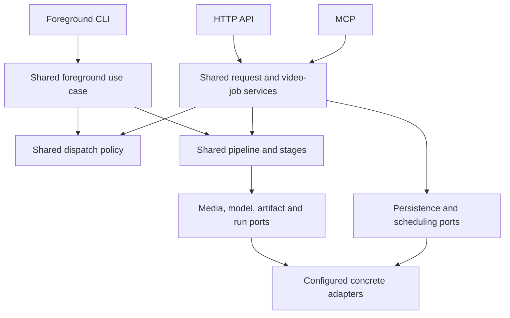

# Scrub


Turn YouTube videos and local audio/video into knowledge artifacts. Scrub
downloads media, transcribes speech, extracts key frames, and assembles a prompt
plus JSON output schema. Optionally run configured vision and summary models to
produce validated analysis, a structured summary, and Markdown. The default local
CLI stops after preprocessing so an agent harness can use its own models.

Use the same processing stages from the local CLI or through persistent background
jobs on a Node host. Submit a video or playlist, disconnect,
and poll for progress and artifacts later. HTTP, MCP, and server-side library
integrations provide job access; a browser dashboard is not included.

## Capabilities

- YouTube videos/playlists and local `.mp3`/`.mp4` input.
- Configurable transcription with local Whisper, faster-whisper, hosted adapters,
  and YouTube captions.
- Scene-based frame extraction with a fallback for sparse scenes.
- Transcript JSON/text, frame manifests, metadata, prompt/schema, manifests, and stats.
- Optional frame analysis, structured summaries, Markdown, and model usage records.
- CLI commands for the full pipeline and individual stages.
- Checkpoint reuse, bounded concurrency, cancellation, and retry through the
  application/storage/runtime adapters.
- Portable core/application source, separate from CLI/API hosting and native adapters.

## Local installation

Use Node.js 22.13+, yt-dlp, FFmpeg/FFprobe, and at least one suitable transcription
adapter. Local transcription needs its executable/package and model assets;
hosted transcription needs the corresponding provider secret.

```bash
git clone https://github.com/jona/scrub-cli.git
cd scrub-cli
npm install
npm run build
npm link

# macOS native tools
brew install ffmpeg uv
uv tool install --upgrade 'yt-dlp[default]' --default-index https://pypi.org/simple
yt-dlp --version

# Optional Python transcription
pip install faster-whisper
```

Run `scrub doctor` to inspect tools/settings, or `scrub transcribers` to inspect
adapters. Local Whisper can be configured with an executable path and model
directory. The container image supplies its own tools and base model.
Before YouTube processing or retries, check the latest stable yt-dlp release and
upgrade the executable Scrub uses. For pip installations, use
`python3 -m pip install --upgrade 'yt-dlp[default]'` in its owning environment.
If using Homebrew's yt-dlp, run `brew update` and `brew upgrade yt-dlp`, then
compare its version with upstream; Homebrew can lag official releases. The
isolated `uv tool` installation above uses PyPI directly. Ensure its executable
directory is on PATH before an older installation.
Set `SCRUB_PYTHON_PATH` to the Python executable containing `faster-whisper` when
it is installed in a different environment from the `python3` on your PATH.

## CLI configuration

The local composition reads `~/.scrub/config.json`. It keeps user settings and
optional provider secrets outside the repository. Server deployments
receive separately injected runtime configuration.

```json
{
  "transcription": {
    "priority": [
      "faster-whisper",
      "local-whisper",
      "openai",
      "youtube-captions"
    ],
    "whisperModel": "base",
    "language": "en"
  },
  "visual": { "enabled": true, "sceneThreshold": 0.4, "maxFrames": 20 },
  "output": { "directory": "~/.scrub/docs", "includeFullTranscript": false },
  "cache": { "directory": ".cache" },
  "localWhisper": {
    "binaryPath": "/path/to/whisper.cpp/main",
    "modelsPath": "/path/to/whisper.cpp/models"
  }
}
```

Optional hosted keys use `apis.openai`, `apis.anthropic`, and `apis.deepgram` in this
user file. `OPENAI_API_KEY` and `ANTHROPIC_API_KEY` environment values take precedence
for vision and summary models. Keep these values out of source control.
Paths may use `~`. Override output with `-o, --output-dir` on `youtube` and `file`.

## CLI commands

```bash
scrub youtube https://www.youtube.com/watch?v=dQw4w9WgXcQ
scrub youtube 'https://www.youtube.com/playlist?list=PL_example123' --max-videos 5 --parallel 2
scrub file ./recording.mp4
scrub file ./podcast.mp3

# Opt in to vision, summary generation, and Markdown rendering
scrub youtube https://www.youtube.com/watch?v=dQw4w9WgXcQ --summarize
scrub youtube https://www.youtube.com/watch?v=dQw4w9WgXcQ --summarize --no-visuals
scrub file ./recording.mp4 --summarize --summary-provider anthropic --vision-provider openai

# Development uses the same local composition
npm run dev -- youtube https://www.youtube.com/watch?v=dQw4w9WgXcQ
```

| `scrub youtube` option                                 | Behavior                                                                                        |
| ------------------------------------------------------ | ----------------------------------------------------------------------------------------------- |
| `-o, --output-dir <path>`                              | Override output directory                                                                       |
| `-t, --transcriber <name>`                             | Select `local-whisper`, `faster-whisper`, `openai`, `deepgram`, or `youtube-captions`           |
| `--no-visuals`                                         | Skip video download, frame extraction, and vision model calls; keep transcription and summaries |
| `--scene-threshold <n>`                                | Scene threshold, default 0.4                                                                    |
| `--max-frames <n>`                                     | Frame limit, default 20                                                                         |
| `-v, --verbose`                                        | Detailed progress                                                                               |
| `--max-videos <n>`                                     | Bound playlist entries                                                                          |
| `--parallel <n>`                                       | Bound per-request concurrent processing, default 1                                              |
| `--no-skip-existing`                                   | Force reprocessing                                                                              |
| `--summarize`                                          | Run configured vision/summary models and render Markdown                                        |
| `--summary-provider <name>` / `--summary-model <name>` | Override the summary selection; requires `--summarize`                                          |
| `--vision-provider <name>` / `--vision-model <name>`   | Override the vision selection; requires `--summarize`                                           |

`file` supports the media options above, excluding playlist options. MP3 input
always skips frames. YouTube input is parsed into canonical, validated video or
playlist identities.

Individual stages remain available:

```text
scrub download <youtube-url> [-o ./download] [--no-video]
scrub prepare <local.mp3|mp4> [-o ./prepare] [--no-video]
scrub transcribe <audio.wav> [-o ./transcript.json] [-t openai] [--text]
scrub extract-frames <video.mp4> [-o ./frames.json] [--output-dir ./frames]
scrub prompt <file> [-o ./summary.prompt.md] [--schema ./summary.schema.json] [--metadata path] [--visuals path]
scrub render <summary.json> [-o ./summary.md] [--metadata path] [--transcript path]
```

`prompt` accepts transcript JSON, plain text, and Markdown. Send its prompt to any
model, validate the response against its schema, then run `render`. Full transcript
rendering follows `output.includeFullTranscript`. No model is selected or called
by these commands.

### Model configuration

The CLI, API, and MCP compositions use the same provider registry. The shipped
profiles are `openai` using the OpenAI-compatible protocol and `anthropic` using
Anthropic's protocol. Public selections are persisted with jobs; credentials and
provider endpoints remain in the server-owned model adapter. Full processing
checks configured credentials and allowed selections before media work begins.

| Setting                                             | Purpose                                                                                       |
| --------------------------------------------------- | --------------------------------------------------------------------------------------------- |
| `OPENAI_API_KEY`, `ANTHROPIC_API_KEY`               | Provider secrets; server environment, local user configuration, or protected deployment input |
| `SCRUB_SUMMARY_PROVIDER`, `SCRUB_SUMMARY_MODEL`     | Default summary selection                                                                     |
| `SCRUB_VISION_PROVIDER`, `SCRUB_VISION_MODEL`       | Default vision selection                                                                      |
| `SCRUB_OPENAI_MODELS`, `SCRUB_ANTHROPIC_MODELS`     | Comma-separated model allowlists                                                              |
| `SCRUB_OPENAI_BASE_URL`, `SCRUB_ANTHROPIC_BASE_URL` | Trusted deployment endpoint overrides                                                         |
| `SCRUB_INFERENCE_LIMITS`                            | JSON object overriding bounded inference limits                                               |
| `SCRUB_MODEL_TIMEOUT_MS`                            | Runtime deadline per model call, 1–1,800,000 ms; default 600,000 ms (10 minutes)              |

Both stages default to `openai`: summaries use `gpt-6.1-sol` and vision uses
`gpt-6.1-terra`. The default OpenAI allowlist includes these models and
`gpt-6-luna`. Selecting `anthropic` without a model override uses
`claude-sonnet-5-5`. Additional model names must appear in the
corresponding allowlist. CLI flags override these public defaults. Library callers
inject a `StructuredModelGateway`; portable code imports no provider SDK.

`SCRUB_INFERENCE_LIMITS` sets the runtime's defaults and request ceilings for
API/MCP jobs. Requests may lower individual budgets, but cannot increase them
above the configured server policy. The CLI loads the same defaults from its
environment. These settings are also available to library callers through the
injected inference settings; the shared pipeline reads no environment variables.

| Budget                          | Default | Behavior                                                                                                                                                                     |
| ------------------------------- | ------- | ---------------------------------------------------------------------------------------------------------------------------------------------------------------------------- |
| `chunkCharacters`               | 48,000  | Maximum source characters per notes/compression chunk; source text is split without truncation                                                                               |
| `maxSummaryInputCharacters`     | 64,000  | Maximum final summary user-prompt characters, including template, metadata, evidence, JSON schema, and repair instructions; a character estimate, not a provider token count |
| `sourceNoteTargetCharacters`    | 9,000   | Soft notes target, reduced to fit the available input budget; oversized valid notes are accepted and compressed if needed                                                    |
| `initialSourceNoteOutputTokens` | 8,192   | Starting generation allowance for a notes/compression call                                                                                                                   |
| `initialOutputTokens`           | 16,384  | Starting generation allowance for a final summary                                                                                                                            |
| `maxOutputTokens`               | 32,768  | Hard ceiling for notes and summary generation; lower ceilings also lower both starting allowances                                                                            |
| `outputTokenRetries`            | 2       | Maximum allowance increases per paid step when the provider reports output truncation; each increase doubles the allowance up to the hard ceiling                            |
| `repairAttempts`                | 1       | Additional attempts for structurally invalid model output                                                                                                                    |
| `maxModelCalls`                 | 128     | Total paid attempts per video, including notes, vision, repairs, and token recovery                                                                                          |

For example, this allows summaries to start at 16,384 tokens and recover up to
32,768 tokens, with a fifteen-minute deadline per call:

```bash
export SCRUB_MODEL_TIMEOUT_MS=900000
export SCRUB_INFERENCE_LIMITS='{"initialOutputTokens":16384,"maxOutputTokens":32768,"outputTokenRetries":2}'
```

Valid notes have no fixed 12,000-character rejection threshold. When their
combined summary prompt exceeds the input budget, the pipeline compresses all
notes in bounded chunks until the prompt fits. It stops if compression does not
shrink the input or the total call budget is exhausted. It never trims source
text to make a prompt fit. Recovery counters and increased allowances are saved
before another paid call, so restarting a worker preserves the budgets and
completed steps. Previously accepted jobs retain their captured settings.

Native tools keep complete, size-bounded stdout for machine-readable results.
Diagnostic stderr and artifact-producing command stdout retain bounded tails;
callbacks stream the full diagnostics. Progress output cannot exhaust an
ever-growing log buffer or fail an otherwise successful download. Deadlines,
cancellation, metadata size checks, and media/artifact size limits remain active.

Provider/model selectors, allowlists, inference budgets, and the model-call deadline are also Docker build arguments. For example,
`--build-arg SCRUB_VISION_PROVIDER=anthropic --build-arg SCRUB_VISION_MODEL=claude-sonnet-5-5`
selects Anthropic for vision. Provider keys are never build arguments.

### Optional LangSmith tracing

CLI and API/MCP hosts can trace model calls through the same server-side adapter. Tracing is off by default. Enable it with
`LANGSMITH_TRACING=true` and supply `LANGSMITH_API_KEY` through an ignored,
owner-only env file or injected server environment. The key is never a
Docker build argument, job setting, result artifact, or browser configuration.

| Setting                           | Default                           | Purpose                                                                    |
| --------------------------------- | --------------------------------- | -------------------------------------------------------------------------- |
| `LANGSMITH_TRACING`               | `false`                           | Strict `true` or `false`; enables model-call tracing                       |
| `LANGSMITH_PROJECT`               | `scrub`                           | Destination project                                                        |
| `LANGSMITH_ENDPOINT`              | `https://api.smith.langchain.com` | HTTPS tracing endpoint without URL credentials, query, or fragment         |
| `LANGSMITH_WORKSPACE_ID`          | Unset                             | Optional workspace selection                                               |
| `SCRUB_LANGSMITH_CAPTURE_CONTENT` | `false`                           | Strict `true` or `false`; explicitly opts into prompt and response capture |
| `SCRUB_LANGSMITH_TIMEOUT_MS`      | `2000`                            | Tracing HTTP deadline, integer 1–10,000 ms                                 |

The default records model selections, step/attempt identifiers, timing, token
usage, and sanitized failure categories. Prompt text, source transcripts, and
model responses are omitted. Opting into content capture uploads prompts and
responses, which may include transcript text and OCR evidence. Known server
credentials are redacted before export. Image pixels are omitted from traces;
image counts describe vision calls.

Only actual model attempts create traces, including retries and note compression.
Reusing cached results creates no new LLM calls or traces. Calls for the same
video share a LangSmith thread ID across execution attempts.

Tracing is best effort: a missing key or unavailable tracing service must not
change a model result or cause pipeline retries. Pending traces drain when the
CLI completes or a server shuts down. These settings belong to deployment
composition; the shared pipeline and entry points do not import LangSmith or
read tracing environment variables. Public tracing settings are also Docker
build arguments; credentials remain server-side.

### Server-side provider credentials

Keep provider keys in the environment or an ignored, owner-only
`.env.models.local` file:

```bash
touch .env.models.local
chmod 600 .env.models.local
```

Set `OPENAI_API_KEY` and/or `ANTHROPIC_API_KEY` for the providers you use. Add
`LANGSMITH_API_KEY` when enabling tracing. Load the file when starting the CLI or
server; Node reads its values without putting them in command arguments:

```bash
node --env-file=.env.models.local dist/deployments/local/cli.js file ./recording.mp4 --summarize
node --env-file=.env.local --env-file=.env.models.local dist/deployments/local/api.js
```

Use [`.env.example`](.env.example) for the server's public runtime settings and
required API bearer token. Keys stay out of source control, Docker build
arguments, image layers, job settings, result artifacts, and browser clients.
A secret manager can inject the same environment values when hosting the server.

Transcript text, frame OCR, and metadata are untrusted source material in prompts.
Model output must pass bounded schema validation before publication.

## Artifacts and cache

The CLI keeps its existing slugged output layout:

```text
<output>/<media-title>/
  source/metadata.json, audio.wav, video.mp4
  transcription/transcript.json, transcript.txt
  frames/frame_*.png, frames.json
  prompt/summary.prompt.md, summary.schema.json
  inference/visual_analysis.json, summary.json, model_usage.json  # --summarize
  output/summary.md                                           # --summarize
  manifest.json
  stats.json
<output>/index.json
```

Video/frame files depend on source type and visual settings. `--summarize` adds
the model-produced artifacts shown above. A harness or the standalone `render`
command can also add inference/rendered files.
The CLI preserves local file metadata and identifiers while projecting portable
pipeline artifacts into this layout.

Durable local checkpoints and blobs live in the configured cache. Later CLI
invocations reuse completed stages when source, settings, pipeline version, and
required blobs match. Existing outputs without a version-two checkpoint are
processed once to populate the new cache; an old index entry alone is not treated
as completed work. Forced reprocessing refreshes generated outputs and preserves
user inference/rendered files. Model selections and inference settings participate
in cache identity. Valid completed model steps are reused after an interrupted
full run; a failed model call or publication does not mark that run completed.

## Background job API

The Node server hosts the Fetch-standard API. `GET /` and `GET /healthz` are
public health checks. Job routes require bearer authentication with
`SCRUB_API_TOKEN`, which must be configured before startup. Keep it in server-side
secret configuration, never browser bundles.

### Standalone server

Create an ignored, owner-only `.env.local` file and configure a nonempty
`SCRUB_API_TOKEN`. Supply provider keys through the server environment or the
existing protected `.env.models.local` file. The server does not read CLI settings
from `~/.scrub/config.json`.

```bash
touch .env.local
chmod 600 .env.local
npm run build
node --env-file=.env.local dist/deployments/local/api.js
```

To load a separate model-key file, add `--env-file=.env.models.local` before the
module path. With environment variables already injected, `npm run start:api`
starts the same host. Both `/jobs` and `/mcp` use one application instance.

| Server setting          | Default / purpose                                               |
| ----------------------- | --------------------------------------------------------------- |
| `SCRUB_DATA_DIR`        | `.local/runtime`; SQLite job state and artifact bytes           |
| `SCRUB_STAGING_ROOT`    | `.local/staging`; disposable native-tool scratch files          |
| `SCRUB_HOST`, `PORT`    | `0.0.0.0`, `8080`; HTTP listening address                       |
| `SCRUB_API_TOKEN`       | Required; authenticated API/MCP access                          |
| `SCRUB_PUBLIC_ORIGINS`  | Optional comma-separated browser origins for MCP behind a proxy |
| `SCRUB_TRANSCRIBERS`    | `youtube-captions,faster-whisper`; ordered native adapters      |
| `SCRUB_PYTHON_PATH`     | `python3`; the image's PATH selects its virtual environment     |
| `SCRUB_RESOURCE_LIMITS` | Optional JSON resource ceilings, shared by every job interface  |

Native executable overrides are `SCRUB_YTDLP_PATH`, `SCRUB_FFMPEG_PATH`,
`SCRUB_FFPROBE_PATH`, `SCRUB_WHISPER_BINARY_PATH`, and `SCRUB_WHISPER_MODELS_PATH`.
The model and concurrency settings below also configure this host.

Keep `SCRUB_DATA_DIR` on persistent storage; container deployments should mount a
volume there. One fenced runtime owns each local data directory. Startup repairs
missing scheduling intents and resumes unfinished work from valid checkpoints.
Shutdown interrupts work for recovery; explicit cancellation remains cancelled
until an explicit retry. Completed results can be read without model credentials.
The optional global native-work cap applies to that application's data root;
independent data roots are separate applications.

HTTP submissions currently accept YouTube video/playlist URLs. Local `.mp3` and
`.mp4` ingestion remains a CLI/library capability; the server does not accept
client-supplied host filesystem paths.

| Route                                             | Result                                                                |
| ------------------------------------------------- | --------------------------------------------------------------------- |
| `POST /jobs`                                      | Accept a video/playlist request; return 202, snapshot, and `Location` |
| `GET /jobs/:id`                                   | Current status, stage, counts, and failure information                |
| `GET /jobs/:id/results?offset=0&limit=20`         | Page video statuses and completed artifact references                 |
| `POST /jobs/:id/cancel`                           | Request cancellation of queued/running work                           |
| `POST /jobs/:id/retry`                            | Retry eligible failed/cancelled work within its budget                |
| `GET /jobs/:id/videos/:video/artifacts/:artifact` | Stream artifact bytes; optional single `Range: bytes=start-end`       |

Submission shape:

```json
{
  "url": "https://www.youtube.com/watch?v=dQw4w9WgXcQ",
  "maxVideos": 5,
  "concurrency": 2,
  "continueOnError": true,
  "skipExisting": true,
  "settings": { "skipVisuals": false, "maxFrames": 20 }
}
```

Use `Idempotency-Key` to identify repeated submissions. A key reused with different
normalized input is rejected. Poll the returned location, then page results using
`offset += items.length`. Advance by the actual number of returned items.
Download the returned artifact references through the
artifact route. Authenticated requests receive 503 when the job gateway is not
configured.

To request full processing explicitly, include public model selections:

```json
{
  "url": "https://www.youtube.com/watch?v=dQw4w9WgXcQ",
  "settings": {
    "inference": {
      "mode": "full",
      "summary": { "provider": "openai", "model": "gpt-6.1-sol" },
      "vision": { "provider": "openai", "model": "gpt-6.1-terra" },
      "includeFullTranscript": false
    }
  }
}
```

Full results include references for visual analysis, structured summary, Markdown,
and model usage. The summary JSON follows the model schema; its title comes from
media metadata and is included in rendered Markdown. Download results through
the same artifact route. API submissions
cannot supply provider secrets or arbitrary provider endpoints.

Background submissions default to full processing using deployment model selections.
Set `settings.inference.mode` to `preprocess` to stop after prompt/schema assembly.
The local CLI and library keep preprocessing as their default.

Each background request uses the shared request coordinator and video-job services.
The runtime supplies local execution and SQLite repositories. Repeated videos
within a request share work; retries resume valid stage checkpoints.
Request scheduling, runner capacity, and an optional global lease cap independently
bound native work. Request concurrency defaults to one; each runner process allows
two native operations by default. The global cap is disabled unless configured.
There is no cross-request shared video cache. SQLite stores durable run records
and chunked artifact bytes; native-tool scratch files are disposable.

### Concurrency controls

| Deployment setting          | Default                    | Allowed value                                           |
| --------------------------- | -------------------------- | ------------------------------------------------------- |
| `SCRUB_REQUEST_CONCURRENCY` | `1`                        | Integer 1–16; used when the request omits `concurrency` |
| `SCRUB_RUNNER_CONCURRENCY`  | `2`                        | Integer 1–64 per runner process                         |
| `SCRUB_GLOBAL_CONCURRENCY`  | Unset or `none` (disabled) | Integer 1–1024 to enable the application-wide lease cap |

An explicit request `concurrency` overrides the request default, while runner and
optional global limits still apply. Multiple requests share each runner's slots;
adding a request does not create another dedicated machine. Empty
strings, zero, fractions, and invalid numeric values are rejected at startup.
The exact value `none` disables the global cap; it is not a numeric zero.

The image build exposes these non-secret settings as build arguments. Runtime
environment values override image defaults:

```bash
npm run build:image -- --load local-api \
  --set local-api.args.SCRUB_REQUEST_CONCURRENCY=2 \
  --set local-api.args.SCRUB_RUNNER_CONCURRENCY=4 \
  --set local-api.args.SCRUB_GLOBAL_CONCURRENCY=8
```

The process keeps a slot until native work and cancellation cleanup finish.
Changing limits takes effect as runners adopt the new deployment; existing work
is allowed to drain.

Set a request's `concurrency` in its HTTP/MCP submission to override the host's
request default. The foreground CLI uses `--parallel` for local playlist workers.

Defaults: six-hour media duration, 512 MiB source/artifact size, 5,000,000 transcript
characters, 10,000 playlist entries, 20 frames (maximum 100), a 30-minute stage
deadline, and three attempts. HTTP bodies are capped at 32 KiB. Requests may lower
resource caps but cannot raise them above server policy. Job execution and artifact
retrieval remain bounded even when a playlist is large.

## MCP interface

MCP exposes the same background job operations through six tools:

| Tool                  | Operation                                                                                                   |
| --------------------- | ----------------------------------------------------------------------------------------------------------- |
| `scrub_submit_job`    | Submit `{ request: <job submission>, idempotencyKey?: string }` and return a durable job ID                 |
| `scrub_get_job`       | Poll a job by `jobId`                                                                                       |
| `scrub_list_results`  | Page video status and artifact references using `jobId`, `offset`, and `limit`                              |
| `scrub_cancel_job`    | Explicitly cancel queued or running work                                                                    |
| `scrub_retry_job`     | Retry eligible work within the configured budget                                                            |
| `scrub_read_artifact` | Read artifact bytes as bounded base64 chunks using `jobId`, `videoId`, `artifactId`, `offset`, and `length` |

Start local MCP over stdio after building:

```bash
npm run build
node dist/deployments/local/mcp.js
```

Each local data directory has one runtime owner. Give a separately launched stdio
process its own `SCRUB_DATA_DIR` while an API process is active. To access jobs
from that API host, connect to its authenticated HTTP `/mcp` endpoint.

Configure an MCP host to launch that Node command with the repository as its
working directory and server-owned model/storage configuration. For protocol
connections, invoke Node directly rather than `npm run start:mcp`: npm's script
banner also uses stdout. The `start:mcp` script is a convenience for interactive
startup. stdout belongs exclusively to the MCP protocol; diagnostics use stderr.

HTTP hosts mount authenticated Streamable HTTP at `/mcp`. The import-safe
`scrub-cli/mcp` export provides `createScrubMcpServer({ jobs })` and
`createMcpHandler({ jobs, authorize, allowedOrigins })`; neither starts a listener.
The host supplies the same `JobGateway` used by HTTP routes and owns its lifetime.
Missing HTTP authorization fails closed. Hosts behind a proxy can provide their
public browser origins through `allowedOrigins`; absent an explicit list, a
browser Origin must match the request URL. SDK clients without Origin still
require authorization. Local stdio trusts the user who launches the process.

Tool inputs reuse shared job validation. Results include structured JSON and a
text representation; generated titles/content remain untrusted data. Result pages
are bounded to 192 KiB of structured payload and may contain fewer items than the
requested limit. Follow `nextOffset` while `hasMore` is true. Artifact reads default
to 16 KiB and allow at most 64 KiB before base64 encoding. Decode each chunk and
follow `nextOffset`; the HTTP artifact route remains available for large downloads.
HTTP MCP messages and stdio input messages are capped at 64 KiB. Disconnecting MCP
does not cancel a durable job; use the explicit cancellation tool. Stopping the
local host closes its runtime; persisted work recovers when that host restarts.

## Portable library and architecture

`src/core` and `src/application` contain no Node built-ins, provider SDKs, or
configuration/environment reads. Application ports use typed values and opaque
artifact references. Native tools, filesystem persistence, and host runtimes are concrete adapters.



The foreground CLI keeps its existing output/cache behavior and processes playlist
occurrences, including forced duplicate occurrences. Durable jobs deduplicate video
membership within each request. Both use the shared dispatch policy and pipeline
stage functions. Request validation/defaults, durable coordination, cancellation,
retry, and video lifecycle live in the application layer; interfaces delegate to
those services. Runtime adapters own timers, admission, fencing, and durable wake delivery.

Infrastructure adapters implement media, model, storage, and runtime ports.
Deployment composition configures those adapters and starts the selected interface.
Changing a host replaces these adapters and composition while preserving the shared
pipeline and interface contracts.

Scrub is a single npm package. Importing `scrub-cli` resolves to `dist/index.js`,
compiled from `src/index.ts`, and exposes the portable core/application API;
`scrub-cli/cli`, `scrub-cli/api`, and `scrub-cli/mcp` expose the corresponding
interface factories, and the installed `scrub` executable starts the local CLI composition.
`scrub-cli/local` exposes the explicit Node application factory for embedding;
construct it with server environment settings and close it when its host stops.
The portable import graph uses Zod as its only external runtime dependency. The
same npm package also installs dependencies for its CLI, Node host, and model
provider adapters.

```text
src/
  core/                     # Models, source parsing, formatting, validation, errors
  application/              # Shared pipeline, settings, jobs and artifact ports/use cases
  application/stages.ts     # Artifact-based processing stages reused by pipeline and CLI
  application/jobs/         # Request/video services, coordination, submission and dispatch policy
  entrypoints/cli/           # Import-safe runCli(argv, dependencies), Commander + Ink
  entrypoints/api/handler.ts # Fetch-standard job HTTP transport
  entrypoints/mcp/           # Job tools and authenticated stateless MCP HTTP transport
  infrastructure/node/      # Media tools, scratch staging, CLI bridge and HTTP host
  infrastructure/node/jobs/ # Persistent SQLite scheduler, ownership fences and local adapters
  infrastructure/transcription/ # Provider adapters and scoped fallback
  infrastructure/model/     # Structured model SDK adapters and provider registry
  infrastructure/filesystem/    # Local run records and compatibility publication
  infrastructure/runtime/   # Runner-process admission and concurrency policy
  deployments/local/cli.ts   # Local executable composition
  deployments/local/api.ts   # Standalone HTTP API + MCP host
  deployments/local/mcp.ts   # Standalone stdio MCP host
  deployments/local/application.ts # Explicit local adapter/service composition
  deployments/model-config.ts # Shared server model defaults and credential-owning factory
  index.ts                  # Portable public exports
```

```bash
npm run typecheck:portable
npm run build
```

`npm run build` emits all source modules to the root `dist` directory.
Adapters supply storage, media processing, transcription, structured models, and run persistence;
`runVideoPipeline` is the same implementation for CLI, API, and MCP jobs. Rendering
receives an explicit timestamp/settings context. Importing the root library API or interface factories starts no server and reads
no deployment configuration.

## Container image

The root Dockerfile builds a native-tool image containing production dependencies,
FFmpeg/FFprobe, Python, the latest stable yt-dlp resolved during build preparation,
`faster-whisper==1.2.1`, and a cached base transcription model. Its default
entrypoint is the local CLI.

Use Docker Buildx and the named Bake profiles to select an interface:

```bash
npm run build:image -- --load local-cli
docker run --rm scrub:local-cli-dev --help
npm run build:image -- --load local-api
```

`npm run build:image` checks official PyPI metadata and refreshes yt-dlp's exact
version and distribution hashes in `deployments/image/requirements.txt` before
Docker can reuse cached layers. A failed upstream check stops preparation. Before
a direct `docker build`, run `npm run update:ytdlp:image` explicitly. The image
installation verifies the complete dependency lock and runs `pip check`;
conflicting dependency changes require refreshing the affected lock entries.
A running container retains its installed version until its image is rebuilt.

| Bake profile | Startup               | Purpose                                                |
| ------------ | --------------------- | ------------------------------------------------------ |
| `local-cli`  | CLI composition       | Foreground commands; the default Bake target           |
| `local-api`  | API composition       | Persistent background jobs through HTTP and MCP        |
| `server-api` | Same API composition  | Host-supplied storage, auth, and listening settings    |
| `local-mcp`  | Stdio MCP composition | An MCP host launches the container with stdin attached |

`TAG` defaults to `dev`, producing tags such as `scrub:local-cli-dev`.
`PLATFORM` defaults to `linux/amd64`. For example,
`TAG=review npm run build:image -- --load local-api` selects
`scrub:local-api-review`. Public settings can use Bake overrides such as
`--set local-api.args.SCRUB_RUNNER_CONCURRENCY=4`.

`SCRUB_ENTRYPOINT` selects the compiled composition module at image build time or
through a runtime environment override. It defaults to
`dist/deployments/local/cli.js`; CLI arguments are forwarded to Node. Additional
hosts can supply their own adapters and compiled composition module through the
same setting.

Keep secrets in runtime configuration. For example, start the API with protected
env files and a named volume for durable state:

```bash
docker run --rm -p 8080:8080 \
  --env-file .env.local --env-file .env.models.local \
  --mount source=scrub-data,target=/data \
  -e SCRUB_DATA_DIR=/data scrub:local-api-dev
```

The API listens on `PORT` (default 8080). Configure a nonempty `SCRUB_API_TOKEN`
in `.env.local`; provider keys belong in `.env.models.local`. Local stdio MCP can
be started with the `local-mcp` image and `docker run --rm -i` so its MCP host owns
stdin/stdout. Secrets are never Docker build arguments or image layers.

Repository image assets are the hash-locked
`deployments/image/requirements.txt` and the required upstream
`faster-whisper-LICENSE` and `whisper-LICENSE` texts under
`deployments/image/licenses/`. Build helpers and assets are separate from the
published npm package.

Download failures emit bounded JSON diagnostics containing the video ID,
operation (`metadata`, `audio`, or `video`), exit status or signal when available,
elapsed time, attempt identity, and up to 8 KiB of redacted stderr. CLI and server
hosts use the same native adapter. Credentials, authentication headers, cookies,
and URL credentials are redacted before logging; public job errors remain generic.
Logging failures do not change a download result or consume pipeline retry budgets.

## Development

```bash
npm run dev -- file ./recording.mp4
npm run typecheck
npm run typecheck:portable
npm test -- --run
npm run build
```

Tests cover the same application pipeline against storage adapters, browser bundle
execution without Node globals, native processes/cancellation, real CLI subprocesses
with fixture executables, Fetch routes/streaming, and persistent job-state recovery.
Live network/media/model checks are separate. Hosted transcription, configured
vision/summary calls, and runner compute use their providers' billing. Preprocessing
alone does not make vision or summary calls.

## License

MIT
